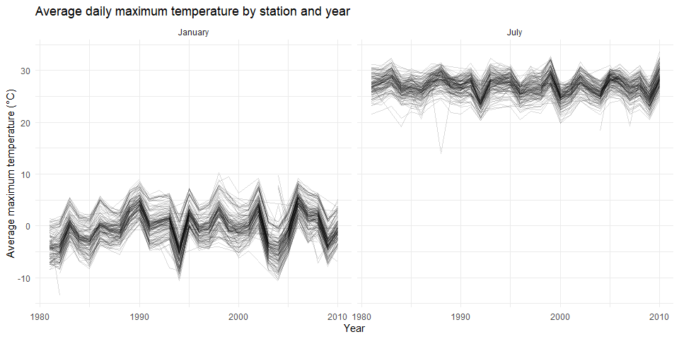
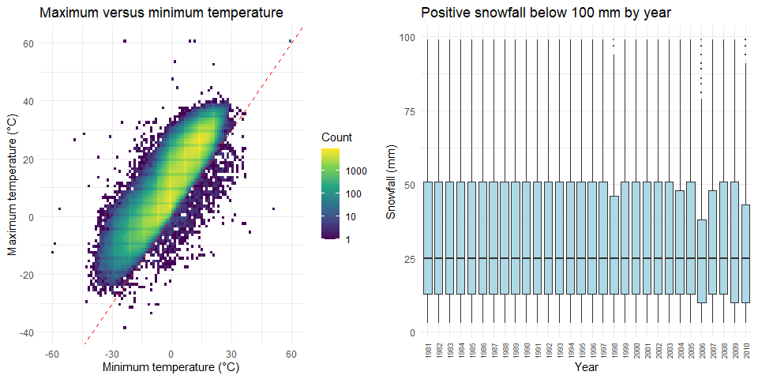
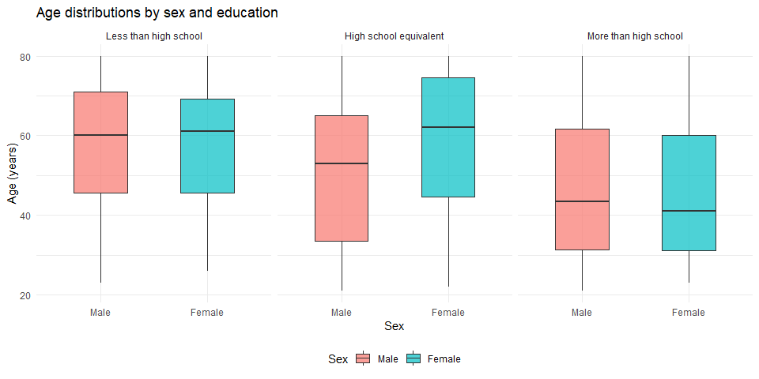
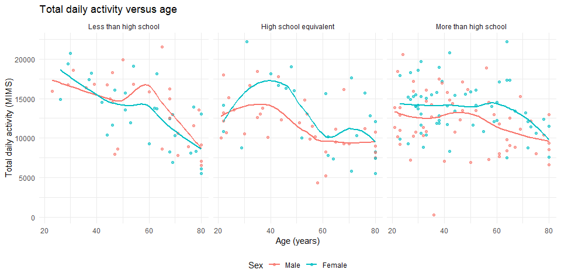
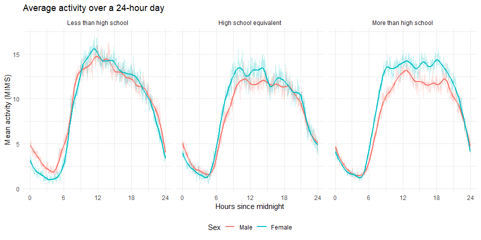
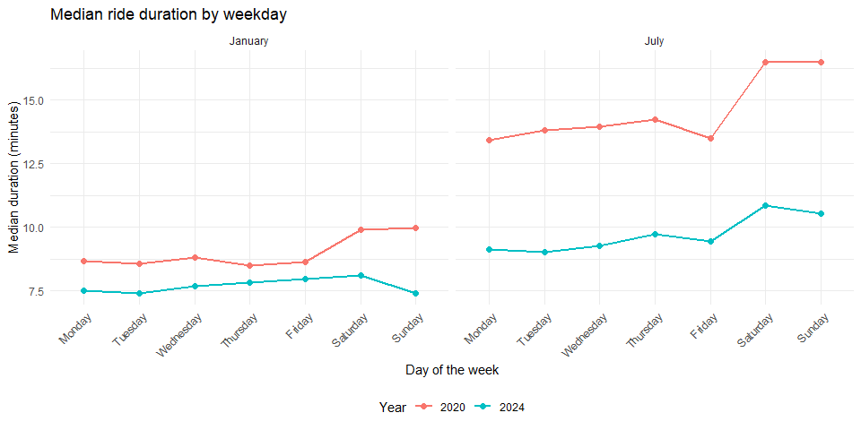
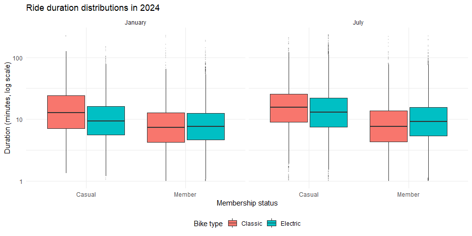

P8105 Homework 3
================
Zhihan(Leila)
2026-10-14

## Problem 1

### Data description

``` r
data("ny_noaa")

missing_df =
  ny_noaa |>
  summarize(across(everything(), ~ mean(is.na(.x)))) |>
  pivot_longer(
    everything(),
    names_to = "variable",
    values_to = "missing_proportion"
  )

knitr::kable(
  missing_df,
  digits = 3,
  col.names = c("Variable", "Proportion missing")
)
```

| Variable | Proportion missing |
|:---------|-------------------:|
| id       |              0.000 |
| date     |              0.000 |
| prcp     |              0.056 |
| snow     |              0.147 |
| snwd     |              0.228 |
| tmax     |              0.437 |
| tmin     |              0.437 |

Missing data are substantial: 43.7% of maximum and minimum temperatures
are missing, compared with 5.6% of precipitation, 14.7% of snowfall, and
22.8% of snow depth. Station IDs and dates are complete.

### Data cleaning and snowfall values

``` r
noaa_df =
  ny_noaa |>
  mutate(
    year = as.integer(format(date, "%Y")),
    month = as.integer(format(date, "%m")),
    day = as.integer(format(date, "%d")),
    tmax = as.numeric(tmax) / 10,
    tmin = as.numeric(tmin) / 10,
    prcp = prcp / 10
  )

snow_frequency_df =
  noaa_df |>
  filter(!is.na(snow)) |>
  count(snow, name = "n") |>
  arrange(desc(n))

knitr::kable(
  head(snow_frequency_df, 10),
  col.names = c("Snowfall (mm)", "Number of observations")
)
```

| Snowfall (mm) | Number of observations |
|--------------:|-----------------------:|
|             0 |                2008508 |
|            25 |                  31022 |
|            13 |                  23095 |
|            51 |                  18274 |
|            76 |                  10173 |
|             8 |                   9962 |
|             5 |                   9748 |
|            38 |                   9197 |
|             3 |                   8790 |
|           102 |                   6552 |

The most common snowfall value is 0 mm, since most days have no snow.
Common positive values, such as 25, 13, and 51 mm, likely reflect
measurements in whole or half inches converted to millimeters.

### Average maximum temperature in January and July

``` r
station_month_df =
  noaa_df |>
  filter(month %in% c(1, 7), !is.na(tmax)) |>
  group_by(id, year, month) |>
  summarize(
    mean_tmax = mean(tmax),
    n_days = n(),
    .groups = "drop"
  ) |>
  mutate(
    month = factor(
      month,
      levels = c(1, 7),
      labels = c("January", "July")
    )
  )

ggplot(
  station_month_df,
  aes(x = year, y = mean_tmax, group = id)
) +
  geom_line(alpha = 0.15, linewidth = 0.3) +
  facet_wrap(~ month, nrow = 1) +
  labs(
    title = "Average daily maximum temperature by station and year",
    x = "Year",
    y = "Average maximum temperature (°C)"
  )
```

<!-- -->

July is much warmer than January. Stations show similar year-to-year
fluctuations, with greater variability in January. A few unusually low
station averages appear in both months

### Temperature relationship and snowfall distributions

``` r
temperature_plot =
  noaa_df |>
  filter(!is.na(tmax), !is.na(tmin)) |>
  ggplot(aes(x = tmin, y = tmax)) +
  geom_bin_2d(bins = 100) +
  geom_abline(
    intercept = 0,
    slope = 1,
    linetype = "dashed",
    color = "red"
  ) +
  scale_fill_viridis_c(trans = "log10") +
  labs(
    title = "Maximum versus minimum temperature",
    x = "Minimum temperature (°C)",
    y = "Maximum temperature (°C)",
    fill = "Count"
  )

snowfall_plot =
  noaa_df |>
  filter(snow > 0, snow < 100) |>
  ggplot(aes(x = factor(year), y = snow)) +
  geom_boxplot(
    fill = "lightblue",
    outlier.alpha = 0.15,
    outlier.size = 0.5
  ) +
  labs(
    title = "Positive snowfall below 100 mm by year",
    x = "Year",
    y = "Snowfall (mm)"
  ) +
  theme(
    axis.text.x = element_text(
      angle = 90,
      hjust = 1,
      vjust = 0.5,
      size = 7
    )
  )

# Display two plots side by side without an additional package.
grid::grid.newpage()
grid::pushViewport(
  grid::viewport(
    layout = grid::grid.layout(nrow = 1, ncol = 2)
  )
)

print(
  temperature_plot,
  vp = grid::viewport(layout.pos.row = 1, layout.pos.col = 1)
)

print(
  snowfall_plot,
  vp = grid::viewport(layout.pos.row = 1, layout.pos.col = 2)
)

grid::popViewport()
```

<!-- -->

Maximum and minimum temperatures are positively associated, with a few
unusual observations, including maximum temperatures below minimum
temperatures. Snowfall distributions are broadly similar across years,
with medians near 25 mm and no clear temporal trend.

## Problem 2

### Load, tidy, and merge the data

``` r
covar_df =
  read_csv(
    "https://p8105.com/data/nhanes_covar.csv",
    skip = 4
  ) |>
  rename(
    seqn = SEQN,
    bmi = BMI
  ) |>
  drop_na() |>
  filter(age >= 21) |>
  mutate(
    sex = factor(
      sex,
      levels = c(1, 2),
      labels = c("Male", "Female")
    ),
    education = factor(
      education,
      levels = c(1, 2, 3),
      labels = c(
        "Less than high school",
        "High school equivalent",
        "More than high school"
      )
    )
  )

accel_df =
  read_csv(
    "https://p8105.com/data/nhanes_accel.csv"
  ) |>
  rename(seqn = SEQN) |>
  pivot_longer(
    cols = starts_with("min"),
    names_to = "minute",
    names_prefix = "min",
    values_to = "mims"
  ) |>
  mutate(
    minute = as.integer(minute),
    hour = (minute - 1) / 60
  )

nhanes_df =
  covar_df |>
  inner_join(accel_df, by = "seqn") |>
  arrange(seqn, minute)
```

The cleaned dataset includes 228 participants aged 21 or older with
complete demographic data. Sex and education are factors, and the merged
data contain 328,320 rows, one per participant per minute, retaining all
original variables.

### Sex counts and age distributions

``` r
education_sex_df =
  covar_df |>
  count(education, sex) |>
  pivot_wider(
    names_from = sex,
    values_from = n,
    values_fill = 0
  )

knitr::kable(
  education_sex_df,
  col.names = c("Education", "Male", "Female")
)
```

| Education              | Male | Female |
|:-----------------------|-----:|-------:|
| Less than high school  |   27 |     28 |
| High school equivalent |   35 |     23 |
| More than high school  |   56 |     59 |

Most participants have more than a high school education. Sex counts are
similar in the lowest and highest education groups, while the high
school equivalent group has more men than women.

``` r
ggplot(covar_df, aes(x = sex, y = age, fill = sex)) +
  geom_boxplot(width = 0.5, alpha = 0.7) +
  facet_wrap(~ education, nrow = 1) +
  labs(
    title = "Age distributions by sex and education",
    x = "Sex",
    y = "Age (years)",
    fill = "Sex"
  ) +
  theme(legend.position = "bottom")
```

<!-- -->

Participants with more than a high school education tend to be younger.
Median ages are similar between sexes in the lowest education group,
while women have a higher median age in the high school equivalent
group.

### Total daily activity and age

``` r
total_activity_df =
  nhanes_df |>
  group_by(seqn, sex, age, bmi, education) |>
  summarize(
    total_activity = sum(mims),
    .groups = "drop"
  )

ggplot(
  total_activity_df,
  aes(x = age, y = total_activity, color = sex)
) +
  geom_point(alpha = 0.6) +
  geom_smooth(
    method = "loess",
    se = FALSE,
    linewidth = 1
  ) +
  facet_wrap(~ education, nrow = 1) +
  labs(
    title = "Total daily activity versus age",
    x = "Age (years)",
    y = "Total daily activity (MIMS)",
    color = "Sex"
  ) +
  theme(legend.position = "bottom")
```

<!-- -->

Total activity generally declines at older ages across education groups,
with substantial individual variation. Women tend to have higher
activity than men in the high school equivalent and more than high
school groups, while sex differences vary with age in the lowest
education group.

### Activity over the day

``` r
activity_time_df =
  nhanes_df |>
  group_by(education, sex, minute, hour) |>
  summarize(
    mean_mims = mean(mims),
    .groups = "drop"
  )

ggplot(
  activity_time_df,
  aes(x = hour, y = mean_mims, color = sex)
) +
  geom_line(alpha = 0.25, linewidth = 0.3) +
  geom_smooth(
    method = "loess",
    span = 0.15,
    se = FALSE,
    linewidth = 1
  ) +
  facet_wrap(~ education, nrow = 1) +
  scale_x_continuous(
    breaks = c(0, 6, 12, 18, 24),
    limits = c(0, 24)
  ) +
  labs(
    title = "Average activity over a 24-hour day",
    x = "Hours since midnight",
    y = "Mean activity (MIMS)",
    color = "Sex"
  ) +
  theme(legend.position = "bottom")
```

<!-- -->

Activity is lowest overnight, rises sharply in the morning, and declines
in the evening across all education groups. Women generally have higher
daytime activity than men, especially in the more than high school
group.

## Problem 3

### Import and clean the data

``` r
jan_2020_df =
  read_csv("data/Jan 2020 Citi.csv") |>
  mutate(year = 2020, month = "January")

july_2020_df =
  read_csv("data/July 2020 Citi.csv") |>
  mutate(year = 2020, month = "July")

jan_2024_df =
  read_csv("data/Jan 2024 Citi.csv") |>
  mutate(year = 2024, month = "January")

july_2024_df =
  read_csv("data/July 2024 Citi.csv") |>
  mutate(year = 2024, month = "July")

citibike_df =
  bind_rows(
    jan_2020_df,
    july_2020_df,
    jan_2024_df,
    july_2024_df
  ) |>
  mutate(
    year = factor(year, levels = c(2020, 2024)),
    month = factor(month, levels = c("January", "July")),
    weekdays = factor(
      weekdays,
      levels = c(
        "Monday", "Tuesday", "Wednesday", "Thursday",
        "Friday", "Saturday", "Sunday"
      )
    ),
    member_casual = factor(
      member_casual,
      levels = c("casual", "member"),
      labels = c("Casual", "Member")
    ),
    rideable_type = factor(
      rideable_type,
      levels = c("classic_bike", "electric_bike"),
      labels = c("Classic", "Electric")
    )
  )
```

The dataset contains 99,485 sampled rides and nine variables from
January and July in 2020 and 2024. Each row represents one ride,
including its ID, bike type, weekday, duration in minutes, stations,
membership status, year, and month. There are 43 missing starting
station names and 207 missing ending station names.

### Ride counts by year, month, and membership

``` r
ride_counts_df =
  citibike_df |>
  count(year, month, member_casual) |>
  pivot_wider(
    names_from = member_casual,
    values_from = n,
    values_fill = 0
  ) |>
  arrange(year, month)

knitr::kable(
  ride_counts_df,
  col.names = c("Year", "Month", "Casual", "Member"),
  format.args = list(big.mark = ",")
)
```

| Year | Month   | Casual | Member |
|:-----|:--------|-------:|-------:|
| 2020 | January |    984 | 11,436 |
| 2020 | July    |  5,637 | 15,411 |
| 2024 | January |  2,108 | 16,753 |
| 2024 | July    | 10,894 | 36,262 |

Members account for most rides in every month. Both casual and member
rides increased from 2020 to 2024 and were more frequent in July than
January, with the highest counts in July 2024.

### Top five starting stations in July 2024

``` r
popular_stations_df =
  citibike_df |>
  filter(
    year == "2024",
    month == "July",
    !is.na(start_station_name)
  ) |>
  count(start_station_name, name = "rides") |>
  slice_max(rides, n = 5, with_ties = FALSE) |>
  arrange(desc(rides))

knitr::kable(
  popular_stations_df,
  col.names = c("Starting station", "Number of rides")
)
```

| Starting station         | Number of rides |
|:-------------------------|----------------:|
| Pier 61 at Chelsea Piers |             163 |
| University Pl & E 14 St  |             155 |
| W 21 St & 6 Ave          |             152 |
| West St & Chambers St    |             150 |
| W 31 St & 7 Ave          |             146 |

Pier 61 at Chelsea Piers had the most starts in the July 2024 sample
(163 rides), followed by University Pl & E 14 St (155 rides). The top
five stations had similar counts, ranging from 146 to 163.

### Median ride duration by weekday

``` r
median_duration_df =
  citibike_df |>
  group_by(year, month, weekdays) |>
  summarize(
    median_duration = median(duration),
    .groups = "drop"
  )

ggplot(
  median_duration_df,
  aes(
    x = weekdays,
    y = median_duration,
    color = year,
    group = year
  )
) +
  geom_line(linewidth = 1) +
  geom_point(size = 2) +
  facet_wrap(~ month, nrow = 1) +
  labs(
    title = "Median ride duration by weekday",
    x = "Day of the week",
    y = "Median duration (minutes)",
    color = "Year"
  ) +
  theme(
    axis.text.x = element_text(angle = 45, hjust = 1),
    legend.position = "bottom"
  )
```

<!-- -->

Median ride durations are longer in July than January and shorter in
2024 than 2020 across all weekdays. Weekend rides are longer in July and
January 2020, but there is no consistent weekend increase in January
2024.

### Ride duration distributions in 2024

``` r
citibike_df |>
  filter(year == "2024") |>
  ggplot(
    aes(
      x = member_casual,
      y = duration,
      fill = rideable_type
    )
  ) +
  geom_boxplot(
    position = position_dodge(width = 0.8),
    outlier.alpha = 0.1,
    outlier.size = 0.5
  ) +
  facet_wrap(~ month, nrow = 1) +
  scale_y_log10() +
  labs(
    title = "Ride duration distributions in 2024",
    x = "Membership status",
    y = "Duration (minutes, log scale)",
    fill = "Bike type"
  ) +
  theme(legend.position = "bottom")
```

<!-- -->

Casual riders have longer median rides than members, and rides are
generally longer in July than January. Electric rides have shorter
medians than classic rides among casual riders, but slightly longer
medians among members. All groups include unusually long rides.
